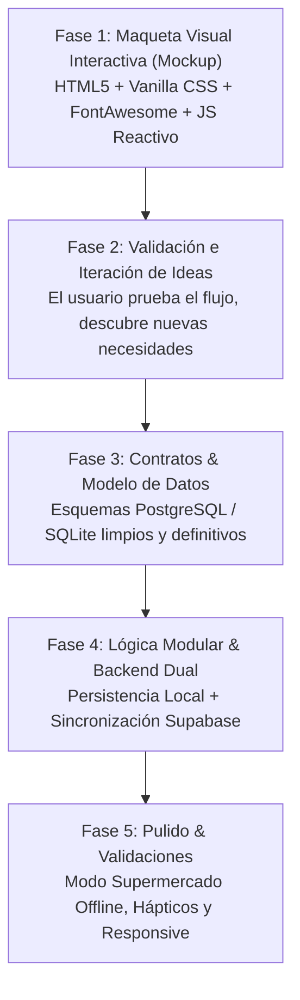

# Directrices de Desarrollo Rezcart: UI-First y Layered Elevation

Esta skill define la metodología obligatoria de diseño, arquitectura y ciclo de desarrollo para Rezcart (Carritos de compra, Gestor de despensas, Recetario, Escáner visual y Chef IA).

---

## 1. Regla de Oro Metodológica: 'UI-First & Mockup Previo'

Bajo ninguna circunstancia se implementarán modelos de base de datos finales, migraciones DDL rígidas ni lógica backend acoplada antes de haber validado la interfaz de usuario interactiva:



### Por qué esta regla es innegociable:
1. Al tocar la maqueta interactiva se descubren casos de uso reales (ej: *"¿y si añado este botón aquí?"*, *"¿y si agrupamos los pasillos de esta forma?"*).
2. Si la base de datos se modela antes, cada cambio de idea en pantalla requiere migraciones dolorosas, borrado de tablas y retrabajo.
3. El mockup interactivo proporciona gratificación inmediata y claridad total sobre la experiencia de usuario.

---

## 2. Sistema de Diseño Visual: 'Layered Elevation' Culinario

### 2.1. Principios Visuales Innegociables
1. **Cero Glassmorphism**: Prohibido el uso de `backdrop-filter: blur()`, fondos borrosos o transparencias lechosas. Contraste nítido y legibilidad perfecta incluso bajo la luz solar directa del supermercado.
2. **Cero Emojis en la UI**: Prohibido usar emojis nativos en botones, cabeceras, badges o navegación. Todos los iconos proceden exclusivamente de **FontAwesome 6** empaquetado localmente en modo offline.
3. **Superficies Sólidas y Elevación**:
   * Canvas / Fondo de app: `#f8fafc` (slate-50).
   * Tarjetas y Paneles: `#ffffff` sólido con borde nítido de `1px solid #e2e8f0`.
   * Sombras estratificadas multicapa:
     ```css
     --shadow-card: 0 1px 3px rgba(15, 23, 42, 0.05), 0 6px 16px -2px rgba(15, 23, 42, 0.03);
     --shadow-card-hover: 0 4px 8px -1px rgba(15, 23, 42, 0.08), 0 14px 24px -4px rgba(15, 23, 42, 0.07);
     ```
4. **Badges Pill Redondeados**:
   * Siempre `border-radius: 9999px`.
   * Padding compacto `0.25rem 0.75rem`, tipografía seminegrita (`font-weight: 600`) y acompañados de un icono FontAwesome.
5. **Paleta Semántica Culinaria**:
   * **Esmeralda / Frescura (`#059669` / `#10b981`)**: Alimentos culinarios, despensa disponible, recetas 100% listas.
   * **Ámbar Cálido (`#d97706` / `#f59e0b`)**: Alerta suave de frescura implícita ("¿Sigue disponible?"), recetas que requieren adaptación.
   * **Coral / Rosa Suave (`#e11d48` / `#ef4444`)**: Alimentos agotados, artículos pendientes o no encontrados.
   * **Índigo / Púrpura Moderno (`#4f46e5` / `#6366f1`)**: Chef IA, escáner de foto de nevera, optimización inteligente.
   * **Slate / Hogar (`#475569` / `#64748b`)**: Artículos no alimentarios (limpieza, ferretería, bazar).

---

## 3. Arquitectura Modular Frontend

El frontend debe organizarse por dominios desacoplados:
* `static/js/core/`:
  * `state.js`: Estado reactivo ligero.
  * `data_service.js`: Capa de datos unificada con modo dual (offline-first).
  * `ui_notifications.js`: Sistema de toasts y confirmaciones hápticas.
  * `formatters.js`: Formateo de cantidades, fechas relativas y tiempos de cocción.
* `static/js/modules/`:
  * `carts.js`: Gestión de múltiples carritos, checklist y checkout guiado.
  * `pantry.js`: Despensa binaria, frescura implícita y check-in de 15 segundos.
  * `vision_scanner.js`: Módulo de captura/simulación de foto de nevera y reconciliación.
  * `recipes.js`: Motor de matching de recetas y asistente Chef IA.
  * `household.js`: Perfiles dietéticos y configuración de comensales.

---

## 4. Evaluaciones y Revisiones
Cualquier análisis, valoración o diagnóstico solicitado por el usuario debe volcarse en un archivo `.md` estructurado en la raíz del repositorio, respondiendo en el chat con un resumen ágil y el enlace al documento.
