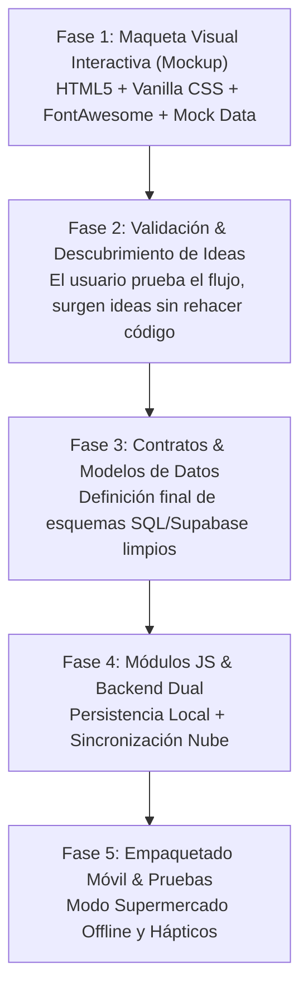

# Rezcart - Manual de Operación y Estándar de Desarrollo

Este documento establece las directrices permanentes de arquitectura, sistema visual y metodología de desarrollo para cualquier tarea o módulo en Rezcart. Cualquier asistente o agente de IA debe adherirse estrictamente a estas directrices.

---

## 1. Sistema de Diseño Visual: 'Layered Elevation' Culinario

### Filosofía Central: Nitidez, Jerarquía y Cero Distracción
* **Cero Glassmorphism:** Prohibido el uso de `backdrop-filter: blur()`, fondos translúcidos turbios o efectos de cristal borroso. Se exige máximo contraste y legibilidad para su uso en supermercados y cocinas.
* **Superficies Sólidas:**
  * Fondo de la aplicación (canvas): `#f8fafc` (slate-50).
  * Tarjetas y paneles: `#ffffff` sólido con borde nítido de `1px solid #e2e8f0`.
* **Profundidad y Elevación:**
  * Sombra base de tarjeta: `box-shadow: 0 1px 3px rgba(15, 23, 42, 0.05), 0 6px 16px -2px rgba(15, 23, 42, 0.03);`
  * Elevación en hover: `transform: translateY(-2px);` con transición suave `cubic-bezier(0.16, 1, 0.3, 1)` y expansión de sombra a `0 4px 8px -1px rgba(15, 23, 42, 0.08), 0 14px 24px -4px rgba(15, 23, 42, 0.07)`.
* **Iconografía:**
  * **Cero Emojis:** Prohibido usar emojis nativos en botones, pestañas, cabeceras o etiquetas.
  * **Librería Oficial:** **FontAwesome 6** empaquetada localmente (`static/js/fontawesome.min.js` o SVG/iconos vectoriales locales offline).
  * **100% Offline:** Debe funcionar sin conexión a internet para garantizar compatibilidad total en zonas de baja cobertura y empaquetado móvil.
* **Badges y Etiquetas:**
  * **Estilo Pill Redondeado:** `border-radius: 9999px;` (nunca esquinas cuadradas).
  * Padding: `0.25rem 0.75rem`, tipografía compacta (`0.75rem`), peso semi-bold (`600`) e icono FontAwesome acompañante.
* **Paleta Semántica Culinaria:**
  * **Frescura y Cocina:** `#059669` (Emerald 600) / Fondo `#ecfdf5`.
  * **Atención y Frescura Implícita:** `#d97706` (Amber 600) / Fondo `#fffbeb`.
  * **Agotado / Pendiente:** `#e11d48` (Rose 600) / Fondo `#fff1f2`.
  * **Chef IA & Escaneo de Foto:** `#4f46e5` (Indigo 600) / Fondo `#eef2ff`.
  * **Bazar / No Alimentario:** `#475569` (Slate 600) / Fondo `#f1f5f9`.
* **Tipografía:**
  * Pila de Sistema Universal Genérica: `-apple-system, BlinkMacSystemFont, "Segoe UI", Roboto, "Helvetica Neue", Arial, sans-serif;`.
  * Cifras de raciones, tiempos y cantidades con `font-feature-settings: "tnum"`.

---

## 2. Metodología de Desarrollo: 'UI-First & Mockup Previo'

El orden de trabajo es estricto e innegociable:

1. **Fase 1 - Maqueta Visual Interactiva (Mockup):** Se construye una maqueta completa y funcional con HTML5, Vanilla CSS y JavaScript reactivo ligero con datos de prueba realistas. El usuario puede abrirla en su navegador, crear listas, simular el escaneo de foto de nevera, transferir a la despensa y ver recetas.
2. **Fase 2 - Validación & Descubrimiento de Ideas:** Antes de escribir una sola tabla de base de datos o endpoint en backend, el usuario valida la experiencia. Si surgen nuevas ideas, se incorporan a la maqueta sin coste de reestructuración de bases de datos.
3. **Fase 3 - Contratos y Modelos de Datos:** Con la interfaz ya validada y cerrada, se redactan los esquemas definitivos de base de datos (PostgreSQL / Supabase / SQLite) sin riesgo de tener que modificarlos después.
4. **Fase 4 - Módulos JS & Backend Dual:** Implementación desacoplada por módulos con modo dual offline-first.
5. **Fase 5 - Pulido y Empaquetado:** Pruebas en pantalla táctil, vibración háptica y responsive.

---

## 3. Arquitectura Modular del Frontend

* `static/js/core/`:
  * `state.js` (estado centralizado reactivo).
  * `data_service.js` (cliente dual con soporte offline y fallback local).
  * `ui_notifications.js` (toasts no intrusivos y feedback sonoro/háptico).
  * `formatters.js` (tiempos de cocción, raciones, fechas relativas sin horas confusas).
* `static/js/modules/`:
  * `carts.js` (múltiples carritos, clasificación automática comida/hogar, checkout guiado).
  * `pantry.js` (despensa binaria, frescura implícita automática, check-in de 15 segundos).
  * `vision_scanner.js` (reconciliación por foto de nevera).
  * `recipes.js` (matching de ingredientes, sugerencias del Chef IA).
  * `household.js` (perfiles dietéticos y comensales).

---

## 4. Regla de Documentación
Toda evaluación, diagnóstico o informe técnico debe generarse en un archivo `.md` en la raíz del repositorio, comunicando al usuario el enlace para su revisión.
