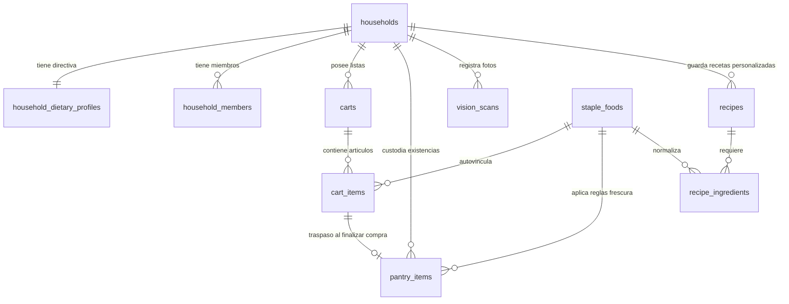

# Contratos de Datos y Esquemas SQL Oficiales (Fase 3: Rezcart)

> **Estado**: Fase 3 Diseñada y Entregada | **Metodología**: UI-First & Mockup Previo  
> **Motor de Persistencia**: PostgreSQL 15+ / Supabase | **Modo de Operación**: Dual Offline-First (IndexedDB outbox) + Realtime

---

## 1. Resumen de la Fase 3

Habiendo validado la experiencia en la maqueta interactiva (Fase 1 y Fase 2) y resuelto todas las decisiones arquitectónicas en la entrevista interactiva `/grill-me`, se han redactado los **Contratos de Datos y Esquemas SQL definitivos de Rezcart**:

* Archivo DDL Oficial: [`sql/01_rezcart_schema.sql`](file:///c:/GitRepository/Rezcart/sql/01_rezcart_schema.sql)
* Archivo de Datos Semilla y Catálogo: [`sql/02_rezcart_seed.sql`](file:///c:/GitRepository/Rezcart/sql/02_rezcart_seed.sql)

---

## 2. Acuerdos de Arquitectura Validados en el `/grill-me`

| Área | Decisión Acordada | Implementación en Base de Datos |
| :--- | :--- | :--- |
| **Hogar y Comensales** | **Híbrido**: Perfil unificado del hogar con raciones por defecto (`household_dietary_profiles`), dejando lista la tabla `household_members` para extender comensales individuales a futuro. | Tablas `households`, `household_dietary_profiles` (1:1) y `household_members` (1:N opcional). |
| **Correspondencia de Alimentos** | **Doble Capa Flexible**: Entrada de texto libre rápida en supermercado (sin bloqueos), vinculando en segundo plano con el catálogo maestro si hay coincidencia. | Clave foránea `staple_food_id NULL` en `cart_items`, `pantry_items` y `recipe_ingredients` contra `staple_foods`. |
| **Gestión de Recetas** | **Recetario Híbrido Unificado**: Recetas clásicas curadas + recetas propias del usuario + recetas guardadas con 1 tap del Chef IA. | Tabla `recipes` con enumerado `recipe_source_type ('curated', 'user', 'chef_ai')`, `substitutions` JSONB y `base_diets` array. |
| **Sincronización y Persistencia** | **Dual Offline-First + Supabase Realtime**: IndexedDB local con cola Outbox (0 ms en el supermercado sin cobertura) y canales Realtime al recuperar conexión. | Publicación en `supabase_realtime` para `carts`, `cart_items`, `pantry_items` y `household_dietary_profiles`. |
| **Escáner Visual de Alimentos** | **Edge Function Multimodal con compresión en cliente**: El móvil reduce la foto antes de enviarla; la función devuelve JSON estructurado de alimentos y confianza. | Tabla `vision_scans` con campo `scan_type ('countertop_bulk', 'zone_audit')` y resultado estructurado en `detected_items` JSONB. |

---

## 3. Diagrama Entidad-Relación (ERD)

---

## 4. Estructura de Tablas del Modelo Oficial

### 4.1. Núcleo de Hogar y Directivas Dietéticas
1. **`households`**: Raíz multi-usuario para compartir carritos y despensa en el hogar.
2. **`household_dietary_profiles`**: Directiva rectora activa del hogar:
   - `base_diet`: `'omnivore'`, `'carnivore'`, `'vegetarian'`, `'vegan'`.
   - `restrictions`: array de restricciones (`'sin_gluten'`, `'sin_lactosa'`, `'keto'`, etc.).
   - `default_servings`: raciones por defecto (1 a 20).
3. **`household_members`**: Registro opcional de miembros individuales para extensiones futuras.

### 4.2. Doble Capa de Alimentos y Carritos
4. **`staple_foods`**: Catálogo canónico con sinónimos (`synonyms`), categoría (`food_category_type`), días estimados de vida útil (`estimated_shelf_days`), alérgenos y bases compatibles.
5. **`carts`**: Múltiples listas de la compra con icono, color y estado activo.
6. **`cart_items`**:
   - `lane`: Pase Dual (`'fresh_pantry'` para comida vs `'household_bazar'` para hogar).
   - `culinary_impact`: Nota de valor culinario (*"Desbloquea Pollo al Ajillo"*).
   - `staple_food_id`: Enlace opcional a alimento maestro.
   - `status`: `'pending'`, `'purchased'`, `'postponed'`.

### 4.3. Despensa Viva y Frescura Automática
7. **`pantry_items`**:
   - `storage_zone`: `'fridge'`, `'pantry'`, `'fruit_bowl'`, `'freezer'`.
   - `purchased_at`: Fecha de compra (sin obligar a meter fechas manuales de caducidad).
   - `estimated_shelf_days`: Vida útil implícita según tipo de alimento.
   - `last_checkin_at`: Registro para el Check-in rápido de 15 segundos.
8. **Vista `view_active_pantry_freshness`**:
   - Calcula al vuelo los días transcurridos (`days_elapsed`), días restantes (`days_remaining`) y la condición de **Bandeja Prioritaria 48h** (`is_priority_48h`).

### 4.4. Recetario y Sustituciones del Chef IA
9. **`recipes`**:
   - `source`: `'curated'`, `'user'`, `'chef_ai'`.
   - `base_diets`: Array de compatibilidad excluyente.
   - `allergens`: Alérgenos presentes.
   - `substitutions`: JSONB estructurado con las recomendaciones de reemplazo del Chef IA.
10. **`recipe_ingredients`**: Ingredientes con cantidad y vínculo opcional a `staple_foods`.
11. **`vision_scans`**: Registro de capturas de encimera o auditorías de nevera con resultado de detección en JSONB.

---

## 5. Próximo Paso Metodológico (Fase 3 -> Fase 4)

Con los esquemas SQL ya redactados e indexados:
1. **Fase 4 (Módulos JS & Backend Dual)**:
   - Implementar el cliente dual en [`static/js/core/data_service.js`](file:///c:/GitRepository/Rezcart/static/js/core/data_service.js) con soporte IndexedDB offline-first.
   - Configurar la sincronización outbox y la conexión con el cliente Supabase.
   - Diseñar la Edge Function para el Chef IA y el procesador de visión multimodal.
