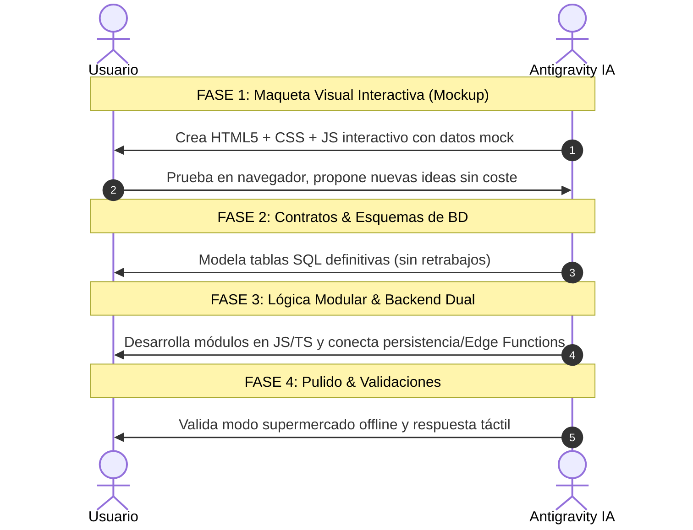

# Estándar Oficial de Desarrollo: Rezcart

> **Arquitectura Visual**: Layered Elevation (Stripe/Linear) | Cero Glassmorphism | Cero Emojis | FontAwesome 6 Offline | Badges Pill | UI-First & Mockup Previo

---

## 1. El Estándar Visual

```css
:root {
    /* Superficies y Fondos */
    --bg-canvas: #f8fafc;        /* Slate-50 suave */
    --bg-card: #ffffff;          /* Blanco sólido puro */
    --bg-subtle: #f1f5f9;        /* Gris claro para barras y cabeceras */
    
    /* Bordes y Líneas */
    --border-subtle: #e2e8f0;    /* 1px nítido */
    --border-hover: #cbd5e1;
    
    /* Tipografía Universal */
    --font-sans: -apple-system, BlinkMacSystemFont, "Segoe UI", Roboto, "Helvetica Neue", Arial, sans-serif;
    --font-mono: ui-monospace, SFMono-Regular, Menlo, Monaco, Consolas, monospace;
    
    /* Jerarquía de Sombras Multicapa (Depth) */
    --shadow-card: 0 1px 3px rgba(15, 23, 42, 0.05), 0 6px 16px -2px rgba(15, 23, 42, 0.03);
    --shadow-card-hover: 0 4px 8px -1px rgba(15, 23, 42, 0.08), 0 14px 24px -4px rgba(15, 23, 42, 0.07);
    
    /* Tokens Culinarios */
    --color-culinary: #059669;   /* Esmeralda para alimentos culinarios */
    --bg-culinary-pill: #ecfdf5;
    --border-culinary: #a7f3d0;
    
    --color-warning: #d97706;    /* Ámbar para frescura a revisar o falta 1 ingrediente */
    --bg-warning-pill: #fffbeb;
    --border-warning: #fde68a;
    
    --color-depleted: #e11d48;   /* Coral para gastados o pendientes */
    --bg-depleted-pill: #fff1f2;
    --border-depleted: #fecdd3;
    
    --color-ai: #4f46e5;         /* Índigo para Chef IA y Foto */
    --bg-ai-pill: #eef2ff;
    --border-ai: #c7d2fe;

    --color-non-food: #475569;   /* Slate para limpieza, hogar y bazar */
    --bg-non-food-pill: #f1f5f9;
    --border-non-food: #cbd5e1;
    
    /* Badges Pill */
    --radius-pill: 9999px;
    --radius-card: 14px;
    --radius-sm: 8px;
}
```

---

## 2. El Flujo de Trabajo Metodológico (UI-First)


