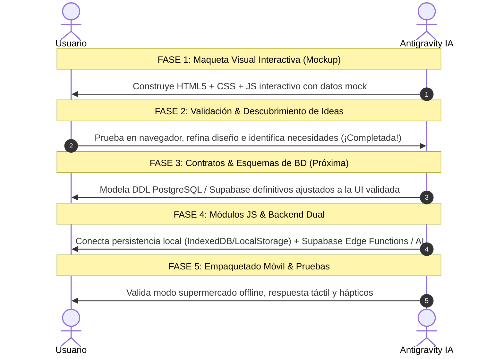

# Estándar Oficial de Desarrollo: Rezcart

> **Arquitectura Visual**: Layered Elevation (Stripe/Linear) | Cero Glassmorphism | Cero Emojis | FontAwesome 6 Offline | Badges Pill | UI-First & Mockup Previo

---

## 1. El Estándar Visual

```css
:root {
    /* Superficies y Fondos (Platino Atelier) */
    --bg-canvas: #f3f4f6;        /* Platino pulcro de cocina profesional */
    --bg-card: #ffffff;          /* Blanco sólido puro */
    --bg-subtle: #e5e7eb;        /* Gris platino suave para controles */
    
    /* Bordes y Líneas */
    --border-subtle: #e2e8f0;    /* 1px nítido */
    --border-hover: #cbd5e1;
    
    /* Tipografía Universal */
    --font-sans: -apple-system, BlinkMacSystemFont, "Segoe UI", Roboto, "Helvetica Neue", Arial, sans-serif;
    --font-mono: ui-monospace, SFMono-Regular, Menlo, Monaco, Consolas, monospace;
    
    /* Jerarquía de Sombras Multicapa (Depth) */
    --shadow-card: 0 1px 3px rgba(15, 23, 42, 0.05), 0 6px 16px -2px rgba(15, 23, 42, 0.03);
    --shadow-card-hover: 0 4px 8px -1px rgba(15, 23, 42, 0.08), 0 14px 24px -4px rgba(15, 23, 42, 0.07);
    
    /* Tokens Culinarios Oficiales: Paleta 4 Atelier Gourmet */
    --color-culinary: #0f766e;   /* Verde Cerceta Profundo (Teal de mandil y frescura) */
    --bg-culinary-pill: #ccfbf1;
    --border-culinary: #99f6e4;
    
    --color-warning: #ea580c;    /* Naranja Yema Cálido (Alerta frescura y Bandeja 48h) */
    --bg-warning-pill: #ffedd5;
    --border-warning: #fed7aa;
    
    --color-depleted: #e11d48;   /* Frambuesa Gourmet (Gastados o reposición) */
    --bg-depleted-pill: #fff1f2;
    --border-depleted: #fecdd3;
    
    --color-ai: #6366f1;         /* Índigo Eléctrico (Chef IA y Escáner Visual) */
    --bg-ai-pill: #eef2ff;
    --border-ai: #c7d2fe;

    --color-non-food: #475569;   /* Pizarra Platino (Hogar, limpieza y bazar) */
    --bg-non-food-pill: #f1f5f9;
    --border-non-food: #cbd5e1;
    
    /* Badges Pill */
    --radius-pill: 9999px;
    --radius-card: 14px;
    --radius-sm: 8px;
}
```
---

## 2. El Flujo de Trabajo Metodológico (UI-First & Mockup Previo)



---

## 3. Impacto de la Maqueta Validada en el Modelo de Datos (Fase 3)

Las decisiones de diseño incorporadas durante la Fase 2 impactan directamente en la arquitectura de datos:

1. **Perfil Dietético y Directivas Culinarias**:
   - `dietary_profiles`: Guarda la dieta base (`omnivore`, `carnivore`, `vegetarian`, `vegan`), raciones por defecto (`servings`), y array de restricciones activas (`sin_gluten`, `sin_lactosa`, `keto`, etc.).
   - `recipes`: Modelo con compatibilidad base (`base_compatibility`), alérgenos (`allergens`), indicador keto (`is_keto`) y catálogo de sustituciones automáticas (`substitutions`).
2. **Carritos de Compra (Pase Dual & Valor Culinario)**:
   - `carts`: Múltiples listas con color, icono y conteo.
   - `cart_items`: Separación `is_food` (frescos/despensa vs bazar/hogar), `culinary_impact` (*"Desbloquea Pollo al Ajillo"*), y estado de compra/traspaso.
3. **Despensa Viva y Frescura Automática**:
   - `pantry_items`: Zona de guardado (`fridge`, `pantry`, `fruit_bowl`, `freezer`), cálculo de vida útil por categoría (sin fechas manuales), y estado para la Bandeja Prioritaria 48h.
4. **Escáner Visual Dual**:
   - `vision_scans`: Registro de fotos para *Nueva Compra* (alta masiva) vs *Auditoría de Zona* (reconciliación 3 columnas).

