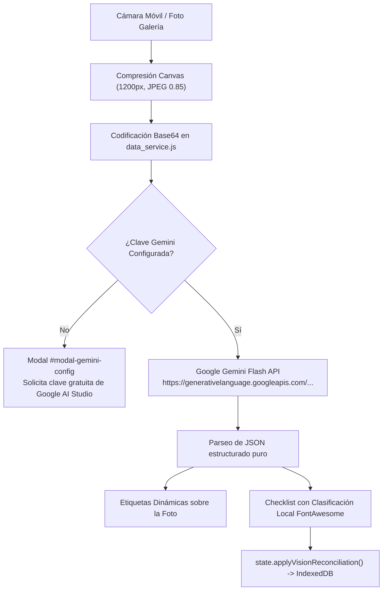

# Rezcart — Informe de Integración: Reconocimiento Visual Real con Google Gemini Flash Vision

Este documento detalla la sustitución de la maqueta simulada de detección visual por la integración real de visión artificial multimodal impulsada por la API de **Google Gemini 1.5 / 2.0 Flash**.

---

## 1. Diagnóstico del Estado Previo vs. Solución Implementada

| Componente | Estado Anterior (Maquetado) | Estado Actual (IA Real en Vivo) |
| :--- | :--- | :--- |
| **Detección Nueva Compra** | Devolvía siempre una lista fija (`Pechuga de pollo`, `Huevos`, `Aguacates`, `Leche`). | Captura el fotograma real de la cámara trasera o foto subida, lo comprime a JPEG y lo envía como `inline_data` Base64 a la API de Gemini. Devuelve únicamente los alimentos reales enfocados. |
| **Auditoría de Zona (Nevera/Despensa)** | Columnas de resultados hardcodeadas con valores estáticos. | Cruza la foto real con la lista actual de existencias en `state.pantry`. Gemini devuelve qué alimentos siguen presentes, cuáles faltan y cuáles son nuevos. |
| **Chef IA** | Generador de plantillas estáticas condicionales. | Invocación en tiempo real a Gemini con directiva mandatoria (omnívora, carnívora, vegetariana o vegana) y alérgenos aplicados. |
| **Entrada de Imagen** | Solo flujo WebRTC (limitado a soporte de cámara web). | Flujo dual: **Cámara en vivo WebRTC** con captura directa de fotograma en canvas + **Selector de archivo nativo** para usar la app de cámara del móvil o la galería fotográfica en alta resolución. |

---

## 2. Arquitectura Técnica de la Integración

### Endpoints y Modelos Configurados
1. **Modelo Principal:** `gemini-1.5-flash` con configuración `responseMimeType: "application/json"` y `temperature: 0.1` para garantizar salida JSON determinista sin etiquetas Markdown (`json`).
2. **Fallback Automático:** En caso de no disponibilidad o cambios de cuota en el tier gratuito, el servicio conmuta automáticamente a `gemini-2.0-flash` o `gemini-1.5-pro`.
3. **Almacenamiento Seguro Local:** La clave API de Google AI Studio se almacena exclusivamente en el navegador del usuario (`LocalStorage` y almacén de settings de `IndexedDB`). Nunca se transmite a intermediarios.

---

## 3. Instrucciones de Uso para el Usuario

1. **Abrir la App en el Móvil:**
   - URL segura pública HTTPS: `https://difficulties-native-sixth-budgets.trycloudflare.com`
2. **Configurar la Clave de Google Gemini:**
   - Toca el botón superior **"Activar IA Real"** (o el icono de la varita/llave en la cabecera).
   - Pega tu clave de API gratuita de [Google AI Studio](https://aistudio.google.com/app/apikey).
   - Pulsa en **"Guardar Clave"** (el botón cambiará a **"Gemini Activo"**).
3. **Escanear Alimentos Reales:**
   - Ve a la pestaña **Despensa**.
   - Pulsa en **"Foto Nueva Compra"** o **"Auditar Zona"**.
   - Apunta con la cámara a los alimentos reales sobre tu mesa o sube una foto con el botón de subida.
   - Pulsa en **"Disparar y Detectar"**.
   - Gemini identificará los alimentos reales con su nivel de confianza y categoría culinaria, permitiéndote guardarlos directamente en tu despensa.
