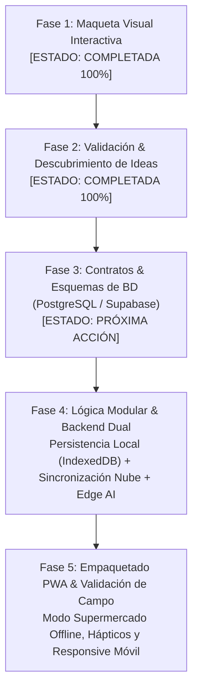

# Plan Maestro de Desarrollo Actualizado: Rezcart

> **Metodología Oficial**: UI-First & Mockup Previo ([AGENTS.md](file:///c:/GitRepository/Rezcart/AGENTS.md))  
> **Sistema Visual**: Layered Elevation Culinario (Paleta 4: Atelier Gourmet & Platino)  
> **Modo**: 100% Offline-First (FontAwesome 6 Local · Sin Emojis · Sin Glassmorphism)

---

## 1. Estado de Situación y Logros Validados (Fase 1 y Fase 2)

Siguiendo el principio de **no escribir tablas de base de datos ni backend rígido hasta validar la experiencia de usuario real**, se ha completado la maqueta interactiva funcional disponible en `http://localhost:8090/`.

Durante las sesiones de prueba con el usuario surgieron mejoras cruciales que redefinieron el alcance:

| Área | Estado Validado en Mockup | Impacto en la Arquitectura |
| :--- | :--- | :--- |
| **Identidad Visual** | Paleta 4 (Atelier Gourmet: Teal `#0f766e`, Naranja Yema `#ea580c`, Frambuesa `#e11d48`, Índigo `#6366f1`). | Variables de diseño unificadas; máximo contraste para cocinas y súper. |
| **Pulso de Cocina** | Barra superior unificada (*Salud de Despensa*, *Cocina Hoy*, *Cesta Activa*, *Perfil Dietético* y botón directo *Chef IA*). | Estado global reactivo sincronizado en tiempo real. |
| **Carritos de Compra** | Pase Dual (*Cesta Fresca* -> traspaso a despensa vs *Hogar/Bazar* -> archivo). Pegar lista WhatsApp integrado. Quick staples de 1 tap. | Los artículos registran categoría semántica y valor culinario (*"Desbloquea X receta"*). |
| **Despensa Viva** | Doble modo de foto (*Nueva Compra* en encimera vs *Auditoría de Zona*). Frescura automática por categoría (sin fechas manuales). Bandeja prioritaria 48h. Check-in 15s. | La despensa calcula el estado de frescura según tipo de alimento y tiempo de almacenamiento. |
| **Directiva Dietética** | De pestaña aislada a directiva rectora: 3 pestañas principales. Dieta base excluyente (*Omnívora*, *Carnívora*, *Vegetariana*, *Vegana*) + Restricciones con sustitución del Chef IA. | El catálogo y el Chef IA filtran o adaptan dinámicamente las recetas según la directiva. |

---

## 2. Hoja de Ruta de Desarrollo en 5 Fases

---

## 3. Especificación Detallada de la Fase 3: Contratos y Esquemas de Base de Datos

Con la experiencia y los casos de uso ya fijados en la maqueta, los esquemas relacionales se diseñarán de forma limpia, robusta y sin riesgo de cambios estructurales:

### 3.1. Módulo Perfil Dietético y Hogar (`dietary_profiles` y `household_settings`)
* **Tabla `dietary_profiles`**:
  * `id` (UUID, PK)
  * `user_id` / `household_id` (UUID, FK)
  * `base_diet` (ENUM: `'omnivore'`, `'carnivore'`, `'vegetarian'`, `'vegan'`)
  * `restrictions` (TEXT[]: `'sin_gluten'`, `'sin_lactosa'`, `'keto'`, `'sin_frutos_secos'`, `'sin_huevo'`, `'sin_marisco'`, `'sin_azucar'`, `'bajo_sal'`, `'bajo_grasa'`)
  * `default_servings` (INTEGER, por defecto 2 raciones)
  * `updated_at` (TIMESTAMPTZ)

### 3.2. Módulo Carritos de Compra (`carts` y `cart_items`)
* **Tabla `carts`**:
  * `id` (UUID, PK)
  * `household_id` (UUID, FK)
  * `name` (TEXT: ej. "Mercadona Semanal", "Frutería", "AliExpress Brico")
  * `color_token` (TEXT)
  * `icon` (TEXT: clase FontAwesome 6)
  * `is_active` (BOOLEAN)
  * `created_at`, `updated_at`
* **Tabla `cart_items`**:
  * `id` (UUID, PK)
  * `cart_id` (UUID, FK)
  * `name` (TEXT)
  * `quantity` (TEXT: ej. "1 kg", "6 uds")
  * `lane` (ENUM: `'fresh_pantry'`, `'household_bazar'`)
  * `culinary_impact` (TEXT, opcional: ej. "Desbloquea Pollo al Ajillo")
  * `is_checked` (BOOLEAN)
  * `status` (ENUM: `'pending'`, `'purchased'`, `'postponed'`)

### 3.3. Módulo Despensa Viva (`pantry_items` y `freshness_rules`)
* **Tabla `pantry_items`**:
  * `id` (UUID, PK)
  * `household_id` (UUID, FK)
  * `name` (TEXT)
  * `category` (ENUM: `'carnes_aves'`, `'lacteos_huevos'`, `'pescados'`, `'verduras_frutas'`, `'despensa_conservas'`, `'congelados'`)
  * `storage_zone` (ENUM: `'fridge'`, `'pantry'`, `'fruit_bowl'`, `'freezer'`)
  * `quantity` (TEXT)
  * `purchased_at` (DATE)
  * `estimated_shelf_days` (INTEGER)
  * `is_priority_48h` (BOOLEAN, generado/computado)
  * `last_checkin_at` (TIMESTAMPTZ)
  * `status` (ENUM: `'active'`, `'depleted'`, `'discarded'`)

### 3.4. Módulo Recetario y Sustituciones (`recipes` e `ingredients`)
* **Tabla `recipes`**:
  * `id` (UUID, PK)
  * `title` (TEXT)
  * `description` (TEXT)
  * `prep_time_minutes` (INTEGER)
  * `base_diets` (TEXT[]: bases compatibles)
  * `allergens` (TEXT[]: alérgenos presentes)
  * `is_keto` (BOOLEAN)
  * `substitutions` (JSONB: mapa de alérgeno -> ingrediente sustitutivo recomendado por Chef IA)
  * `instructions` (JSONB / TEXT[])
  * `created_at`
* **Tabla `recipe_ingredients`**:
  * `id` (UUID, PK)
  * `recipe_id` (UUID, FK)
  * `name` (TEXT)
  * `amount` (TEXT)
  * `is_optional` (BOOLEAN)

### 3.5. Módulo Escáner Visual (`vision_scans`)
* **Tabla `vision_scans`**:
  * `id` (UUID, PK)
  * `household_id` (UUID, FK)
  * `scan_type` (ENUM: `'countertop_bulk'`, `'zone_audit'`)
  * `target_zone` (TEXT, opcional: 'nevera', 'despensa', 'frutero')
  * `image_url` (TEXT)
  * `detected_items` (JSONB: lista de alimentos extraídos con nivel de confianza)
  * `status` (ENUM: `'pending_review'`, `'applied'`)

---

## 4. Especificación Detallada de la Fase 4: Módulos JS & Backend Dual

1. **Persistencia Local Offline (IndexedDB con fallback LocalStorage)**:
   - Todo lo que el usuario haga en el supermercado funciona sin conexión.
   - Sincronización en cola (outbox pattern) cuando vuelve la cobertura.
2. **Sincronización en Nube (Supabase)**:
   - Row Level Security (RLS) para aislamiento por hogar/usuario.
   - Supabase Realtime para carritos compartidos (si dos personas compran a la vez).
3. **Servicios de IA en Edge Functions**:
   - **Chef IA**: Edge function con LLM (Gemini / Claude / OpenAI) inyectando la despensa real + directiva dietética en el system prompt.
   - **Vision Scanner**: Edge function para análisis multimodal de la foto de encimera o nevera.

---

## 5. Especificación Detallada de la Fase 5: Empaquetado Móvil & Pruebas

1. **Configuración PWA**:
   - `manifest.json` culinario con iconos en alta resolución.
   - `service-worker.js` con cacheo estático y estrategia Network-First con fallback a Cache.
2. **Hápticos y Ergonomía Móvil**:
   - `navigator.vibrate(10)` al tachar artículos en el carro.
   - Botones con área táctil mínima de 44x44 px para uso con una sola mano.
